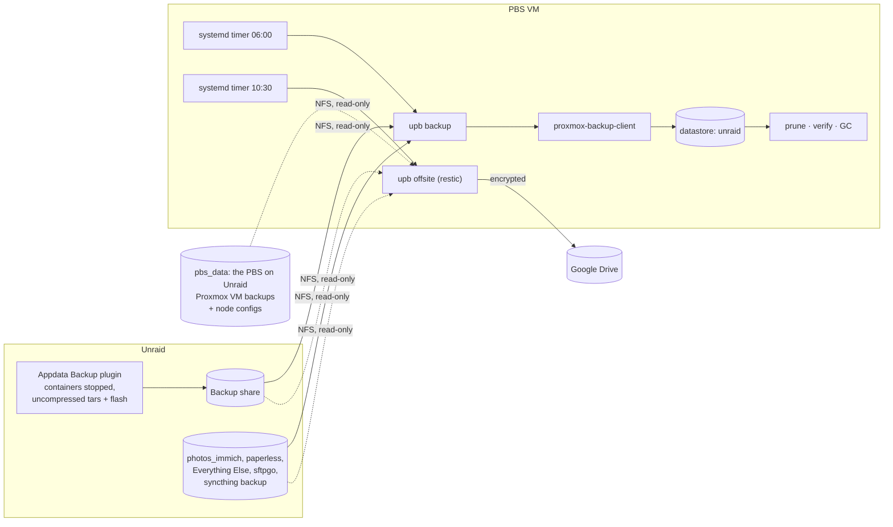

# unraid-to-proxmox-backups

Nightly, deduplicated backups of the things on an Unraid server that can't be
downloaded again (appdata, flash drive, photos, documents) into a
**Proxmox Backup Server** (PBS) running as a Proxmox VM.

The PBS VM **pulls** the data: it mounts the Unraid shares read-only over
NFS and backs them up with the official `proxmox-backup-client`. Nothing is
installed on Unraid, and Unraid holds no credentials.

Optionally, it also copies everything **encrypted to Google Drive** with
restic, including the datastore of the PBS on Unraid that holds your Proxmox
VM backups, and each **Proxmox node backs up its own configuration** to that
PBS.



## Why this design

Each part is a tool other people already run and maintain:

- **Appdata Backup** (Unraid plugin) makes consistent copies of appdata,
  with each container stopped during its backup, plus the flash drive.
- **Immich** writes its own nightly database dumps into its library.
- **proxmox-backup-client** runs natively on PBS (Debian), with no fighting
  Unraid's RAM root filesystem.

This repo is the small glue between them: an NFS mount per share, a
systemd timer, safety checks, notifications, and the PBS setup.

What that gives you:

- **Unraid can't touch the backups.** It has no credentials, and the exports
  are read-only. The API token upb uses can only *add* snapshots, and
  retention runs on PBS.
- **Incremental and deduplicated.** With `metadata` change detection,
  unchanged files aren't even re-read. The appdata tars deduplicate against
  the previous night's once the plugin's compression is off.
- **Checked on PBS.** Scheduled verify jobs re-read and checksum everything.
- **Loud failures.** Email, ntfy or healthchecks.io. Healthchecks.io also
  catches runs that never happened.
- **Safe by default.** Mounts are forced read-only, an empty or unmounted
  share is never backed up in place of the real one, and the Appdata Backup
  share is only read once the plugin has stopped writing.

## What gets backed up

Each job in `/etc/upb/jobs.d/` names one Unraid folder and becomes a backup
group `host/unraid-<job>` on PBS:

| Job | Unraid folder | Contents |
|---|---|---|
| `appdata-backup` | `Backup/appdata backup` | Newest Appdata Backup run: every container's appdata, Postgres included, taken stopped |
| `flash-backup` | `Backup/flash drive backup` | Newest flash drive backup |
| `photos-immich` | `photos_immich` | Immich library, without thumbnails and transcoded video |
| `paperless` | `paperless` | Paperless-ngx documents |
| `everything-else` | `Everything Else` | |
| `sftpgo` | `sftpgo` | |
| `syncthing-backup` | `syncthing backup` | |
| `pbs-data` | `pbs_data` | The PBS on Unraid's datastore: Proxmox VM backups and node configs. Google Drive only, off by default |

On Google Drive, all enabled jobs, encrypted: [docs/offsite.md](docs/offsite.md).
Each Proxmox node's own settings (`/etc` with `/etc/pve`, `/root`, the
cluster database) go to the PBS on Unraid: [docs/pve-host-backup.md](docs/pve-host-backup.md).

To add a share, drop another file in `jobs.d/`. Left out on purpose: the
media shares (huge, and they can be downloaded again), `system` (the Docker
image, rebuilt from the templates on the flash drive), and `pbs_data` /
`proxmox` (backup storage, not data to back up).

## Setup

1. **Unraid**: turn off compression in Appdata Backup, then export the
   `Backup` share and the other shares above over NFS, read-only, to the PBS
   VM's IP. See [docs/unraid-setup.md](docs/unraid-setup.md).
2. **PBS VM**: run `./install.sh`, `./proxmox/pbs-setup.sh`, review
   `/etc/upb/`, then:
   ```sh
   upb check
   upb backup
   systemctl enable --now upb-backup.timer
   ```
   See [docs/pbs-setup.md](docs/pbs-setup.md).
3. **Try a restore**: see [docs/restore.md](docs/restore.md).
4. **Optional, Google Drive**: [docs/offsite.md](docs/offsite.md).
5. **Optional, Proxmox node settings**: `bash install.sh --pve-host` on each
   node, see [docs/pve-host-backup.md](docs/pve-host-backup.md).

## Commands

| Command | Does |
|---|---|
| `upb backup [--dry-run] [JOB...]` | Back up all enabled jobs, or only the named ones |
| `upb list` | Jobs, whether they're enabled, their PBS group and export |
| `upb check` | Validate config, test the token, mount every enabled export |
| `upb snapshots [JOB]` | List snapshots |
| `upb restore JOB DIR [SNAPSHOT]` | Restore into an empty local directory (latest snapshot by default) |
| `upb mount JOB DIR [SNAPSHOT]` | Mount a backup read-only, e.g. to `rsync` it back to Unraid |
| `upb shell JOB [SNAPSHOT]` | Browse a backup interactively and restore single files |
| `upb init-key` | Create an encryption key (optional, see docs) |
| `upb client ARGS...` | Any `proxmox-backup-client` command, with the repository and token already set |
| `upb offsite [--dry-run] [JOB...]` | Copy all enabled jobs to Google Drive (restic), then apply retention |
| `upb offsite-init` | Create the offsite repository (once) |
| `upb restic ARGS...` | Any restic command against the offsite repository, e.g. `upb restic snapshots` |
| `upb host-backup [--dry-run]` | On a Proxmox node: back up its configuration to PBS |
| `upb host-restore DIR [SNAPSHOT]` | On a Proxmox node: restore its configuration backup into an empty folder |
| `upb host-client ARGS...` | On a Proxmox node: any `proxmox-backup-client` command against the host backup repository |

## Repository layout

```
bin/upb                  CLI entry point
lib/                     common, jobs, nfs, pbs, notify, offsite (restic), host (Proxmox nodes)
config/                  upb.conf, host-backup.conf and job templates (copied to /etc/upb by install.sh)
systemd/                 upb-backup, upb-offsite and upb-host-backup services and timers
proxmox/pbs-setup.sh     datastore or namespace, backup-only token, prune/verify/GC schedules
install.sh               installs upb on the PBS VM, or with --pve-host on a Proxmox node
docs/                    Unraid setup, PBS setup, restore, offsite, Proxmox node backups
tests/                   bats tests with stubs for mount, the clients, restic, mail, curl
```

## Development

```sh
make lint   # shellcheck
make test   # bats
```

CI runs both on every push.
