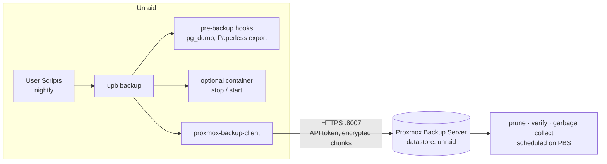

# unraid-to-proxmox-backups

Nightly, encrypted, deduplicated backups of the things on an Unraid server
that can't be downloaded again (flash drive, appdata, databases, photos,
documents) to a **Proxmox Backup Server** (PBS).

The tool is `upb`: a few bash scripts around the official
`proxmox-backup-client`, scheduled by the Unraid User Scripts plugin.



## Why this design

- **Incremental and deduplicated.** PBS stores content-addressed chunks, and
  with `metadata` change detection unchanged files aren't even re-read. After
  the first run, a multi-TB photo library backs up in minutes.
- **Encrypted before it leaves Unraid.** PBS only sees ciphertext.
- **Unraid can't delete its own backups.** The API token has the
  `DatastoreBackup` role: it can add snapshots but can't prune or delete
  them. Retention runs on PBS, so ransomware on Unraid can't wipe the history.
- **Consistent databases.** Postgres is dumped with `pg_dump` while it runs.
  Containers that use SQLite can be stopped for the few minutes their backup
  takes and are always restarted afterwards.
- **Checked on PBS.** Scheduled verify jobs re-read and checksum the stored
  data.
- **Loud failures.** Unraid notifications plus an optional healthchecks.io
  ping, which also catches runs that never started.

## What gets backed up

Every job is one bash file in `/boot/config/upb/jobs.d/` and becomes one
backup group on PBS (`host/unraid-<job>`). The defaults:

| Job | Enabled | Contents |
|---|---|---|
| `flash` | yes | `/boot`: Unraid config, disk assignments, Docker templates, license key |
| `databases` | yes | `pg_dumpall` of `PostgreSQL_Immich` and `postgresql17` |
| `appdata` | yes | `/mnt/user/appdata`, without Plex caches, transcodes and logs |
| `immich` | after you check the path | Immich photo library, without thumbnails and transcoded video |
| `paperless` | after you check the path | Paperless-ngx `document_exporter` output |
| `shares` | after you add shares | important user shares (documents, Syncthing, …) |

The media library is left out on purpose. It's most of the array, and it can
be downloaded again.

## Quick start

1. **Proxmox side**: install PBS and run `proxmox/pbs-setup.sh` on it. It
   creates the datastore, a backup-only API token, and the prune, verify and
   GC schedules. See [docs/proxmox-setup.md](docs/proxmox-setup.md).
2. **Unraid side**: copy this repo to the server and run `bash install.sh`.
   Then fill in `/boot/config/upb/upb.conf`, paste the token secret, and run:
   ```sh
   upb init-key            # encryption key: store the printed copy offline!
   upb check               # config, jobs and connection
   upb backup --dry-run    # shows exactly what would run
   upb backup              # first full backup
   ```
   See [docs/unraid-setup.md](docs/unraid-setup.md).
3. **Schedule**: Settings > User Scripts > `upb-backup` > Custom `0 3 * * *`.
4. **Test a restore**: see [docs/restore.md](docs/restore.md). A backup you've
   never restored from is only a hope.

## Commands

| Command | Does |
|---|---|
| `upb backup [--dry-run] [JOB...]` | Run all enabled jobs, or only the named ones |
| `upb list` | Show jobs, whether they're enabled, their PBS group and sources |
| `upb check` | Validate config and jobs, test the connection and token |
| `upb snapshots [JOB]` | List snapshots on PBS |
| `upb restore JOB ARCHIVE DIR [SNAPSHOT]` | Restore an archive into an empty directory (latest snapshot by default) |
| `upb shell JOB ARCHIVE [SNAPSHOT]` | Browse a snapshot interactively and restore single files |
| `upb init-key` | Create the encryption key and print a paper copy |
| `upb install-client [--from FILE]` | Download the static `proxmox-backup-client`, or install it from a file |
| `upb client ARGS...` | Any `proxmox-backup-client` command, with the repository and credentials already set |

## Writing a job

```bash
# /boot/config/upb/jobs.d/60-nextcloud.conf
JOB_ENABLED=true
SOURCES=(                       # "<archive-name>:<directory>", one archive each
  "data:/mnt/user/nextcloud"
)
EXCLUDES=("**/cache/" "*.part") # gitignore-style patterns
STOP_CONTAINERS=(nextcloud)     # stopped after pre_backup, always restarted

pre_backup() {                  # runs with `set -e`: any failing command skips the backup
  dump_postgres nextcloud-db nextcloud nextcloud   # container, user, database
}
post_backup() {                 # runs whenever pre_backup succeeded; $1 = exit code
  [[ $1 -eq 0 ]] || echo "backup failed" >&2
}
```

Order: `pre_backup` (databases are still running) → stop containers →
backup → start containers → `post_backup`. Files that hooks write to
`$JOB_DUMP_DIR` are uploaded as a `dumps` archive in the same snapshot.
`BACKUP_ID=...` overrides the group name. Helpers available in hooks:
`dump_postgres`, `docker_exec`, `info`, `warn`, `error`.

## Security notes

- The **encryption key** (`/boot/config/upb/secrets/encryption.key`) is the
  one thing you can't lose. `upb init-key` prints a paper copy: keep it in a
  password manager or on paper, away from the server. The flash backup skips
  the secrets folder on purpose.
- The **API token** can only add backups to its datastore. For a restore
  after a disaster, root on PBS works too.
- Turning encryption off (`PBS_ENCRYPTION=false`) lets you browse and
  download files in the PBS web UI, at the cost of PBS seeing plaintext.

## Repository layout

```
bin/upb                     CLI entry point
lib/                        common, pbs, docker, jobs, notify, install_client
config/                     upb.conf and job templates (copied by install.sh)
unraid/user-scripts/        the scheduled User Script
proxmox/pbs-setup.sh        one-time PBS preparation (run on the PBS host)
docs/                       setup and restore guides
tests/                      bats tests with docker/client stubs
```

## Development

```sh
make lint   # shellcheck
make test   # bats
```

CI runs both on every push.

## Ideas / next steps

- Offsite copy: a PBS sync job to a second PBS, or an S3 datastore (PBS 4).
- ZFS snapshot of the appdata pool before the backup, for crash-consistent
  copies without stopping containers.
- A monthly scheduled restore test of a small archive.
- A job for libvirt VM disks (`/mnt/user/domains`) if VMs move to Unraid.
